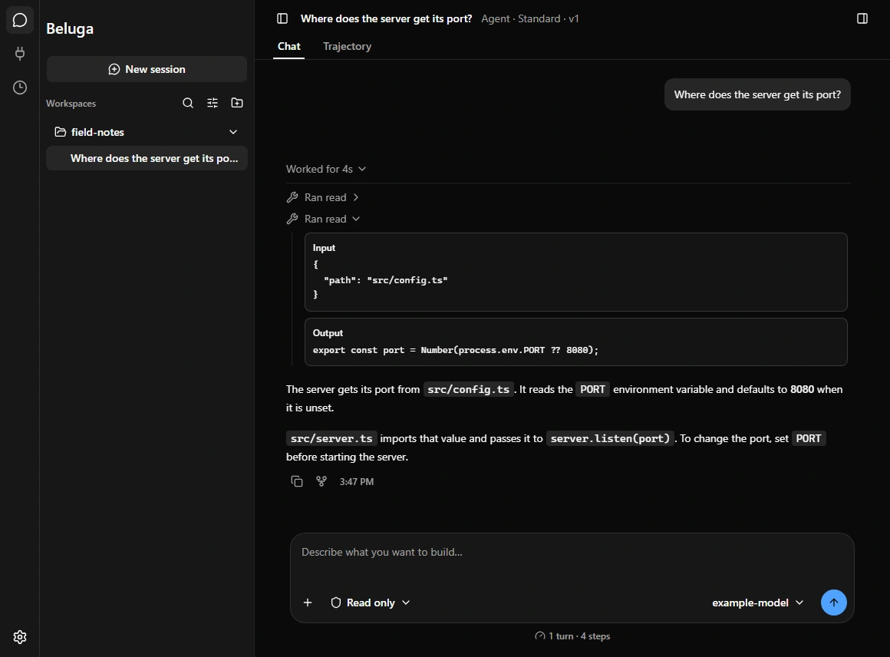

<p align="center">
  
</p>

<h1 align="center">Beluga</h1>

<p align="center">
  A self-hosted coding agent inspired by DeepSeek Harness.<br>
  Open a project folder, choose a model, and see what the agent read and ran.
</p>

<p align="center">
  <a href="#install"><strong>Get started</strong></a> ·
  <a href="https://github.com/nbsp1221/beluga/releases">Releases</a> ·
  <a href="docs/hosting.md">Host guide</a>
</p>



_In this sample workspace, Beluga reads `src/config.ts` to explain where the server gets its port._

## Install

**Public preview.** Choose where you want to run the agent.

### Windows

Download the Windows x64 portable ZIP from [Releases](https://github.com/nbsp1221/beluga/releases), verify its SHA-256 checksum, and extract the whole folder before opening `Beluga.exe`. It starts a Host on your computer and can also connect to a remote Host. [Windows setup](docs/hosting.md#windows-desktop)

### Linux server

On Linux x64, use Node.js 24 LTS, a systemd user session, and a [writable npm global prefix](https://docs.npmjs.com/resolving-eacces-permissions-errors-when-installing-packages-globally/). Run as your regular user:

```sh
npm install -g @retn0/beluga@preview
beluga service install
```

Open `http://127.0.0.1:8917` on the Host and sign in with the printed access code. [Linux setup and remote access](docs/hosting.md#linux-user-service)

### Docker

Use the versioned image listed in the [release notes](https://github.com/nbsp1221/beluga/releases). The [Docker setup guide](docs/hosting.md#docker) shows how to keep your data and mount your project folders.

When you connect to a remote Host, Beluga opens project files, runs tools, and saves conversations on that machine. See the [remote access guide](docs/hosting.md#access-the-host).

## First conversation

1. Open your Beluga Host and sign in with its access code. A desktop app running its own Host opens directly.
2. Open **Settings → Providers**. Connect Codex using the existing Codex CLI login for the Host's account, or add an OpenAI-compatible provider. Choose a model.
3. Select **Add workspace**, choose a project folder on the Host, and send a text message. Try asking where the project loads its configuration.

New conversations start in **Read only**. Choose **Workspace write** to let the agent edit files in the workspace, or **Full access** to let it run commands with the Host account's permissions. Read and search tools can open explicitly named paths that the Host account can read, including paths outside the workspace.

## Features

- **Pick up where you left off.** Keep conversations together by project folder so you can return to earlier work.
- **Choose what the agent can do.** Explore code in Read only, or grant write or shell access when the task calls for it.
- **See how it got there.** Open Trajectory to inspect the tool calls and model requests behind a response.

## Documentation

- [Host setup and operations](docs/hosting.md)
- [Build from source and contribute](docs/development.md)
- [Architecture](docs/architecture.md)
- [Third-party notices](THIRD_PARTY_NOTICES.md)

Beluga's interface and plugin architecture were inspired by [DeepSeek Harness](https://github.com/deepseek-ai/deepseek-harness).

## License

Beluga is released under the [MIT License](LICENSE).
